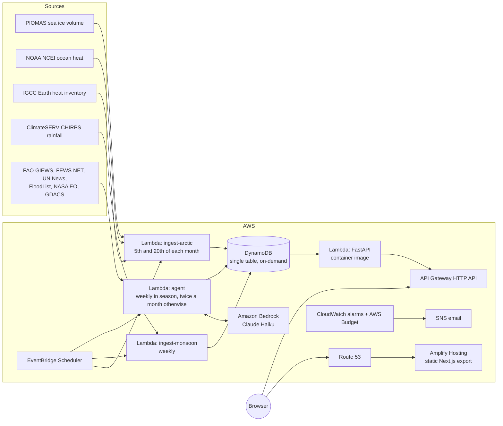

# Climate Hubris

A two-part climate dashboard built on public data:

- **Arctic sea ice.** Ice volume today against the same date in 1979, the oldest year on record; the full PIOMAS record with global ocean heat content overlaid on a second axis; a deliberately simple projection of the first ice-free September (a Blue Ocean Event) from ocean heat extended at its rate since 2020, with controls to change its assumptions; and Earth's net energy imbalance.
- **Global monsoon monitor.** Six monsoon systems and the 58 subregions inside them, scored on rainfall against the 1991–2020 normal and on what humanitarian and meteorological bulletins explicitly report, extracted by an LLM agent that has to quote its source verbatim. Every box on the map is sized by the cereals grown there; clicking a region zooms in to its subregions.

The full feature list is in [FEATURES.md](FEATURES.md). Every figure shows the newest value its source has published and when the system last checked. It is designed to run at `climate.akash.ucsciba.org` for a few dollars a month.

## Architecture



All four Lambdas run the **same Docker image** (`backend/Dockerfile`); the scheduled ones override the handler. The same image runs the API locally under Docker Compose, and would run unchanged on ECS Fargate if traffic ever justified an always-on service.

| Layer | Choice | Why |
|---|---|---|
| Frontend | Next.js static export on Amplify Hosting | Matches how `akash.ucsciba.org` is already hosted (Amplify, manual zip deploys) |
| API | FastAPI + Mangum on Lambda (container), HTTP API | No idle cost; throttled at 10 requests/s so a spike cannot run up a bill |
| Jobs | EventBridge Scheduler → Lambda | Free at this volume |
| Storage | DynamoDB on-demand, one table | Each dataset is one partition, so each read is one `Query` |
| Agent | LangChain + Claude Haiku on Amazon Bedrock | IAM-authenticated, so there is no API key to store. OpenAI is supported as an alternative (below) |
| Alerts | CloudWatch billing alarm, AWS Budget, job-failure alarm → SNS email | |

## Data sources

| Data | Source | Notes |
|---|---|---|
| Sea ice volume | [PIOMAS v2.1](https://psc.apl.uw.edu/research/projects/arctic-sea-ice-volume-anomaly/), monthly CSV and daily file | Volume in 10³ km³, 1979 onwards |
| Ocean heat content | [NOAA NCEI](https://www.ncei.noaa.gov/access/global-ocean-heat-content/) yearly basin files | 0–700 m from 1955, 0–2000 m from 2005. Published in 10²² J; stored in ZJ |
| Earth's energy imbalance | [Indicators of Global Climate Change](https://github.com/ClimateIndicator/data) Earth heat inventory | Heat accumulated since 1971, in ZJ. The imbalance is its 5-year rate of change in W/m². NASA CERES (the satellite record of energy in and out) needs an Earthdata login, so it is not used |
| Rainfall | CHIRPS via [ClimateSERV](https://climateserv.servirglobal.net) | Daily area average per region and subregion (64 boxes), stored as monthly totals. About six weeks behind real time |
| Food production | [World Bank AG.PRD.CREL.MT](https://data.worldbank.org/indicator/AG.PRD.CREL.MT) (FAO), with state shares from India's Ministry of Agriculture, China's NBS, Brazil's IBGE and ABARES | A fixed table in [`backend/app/food.py`](backend/app/food.py): cereals, million tonnes a year, 2022–2024 |
| Reported conditions | FAO GIEWS country briefs, FEWS NET regional pages, UN News, FloodList, NASA Earth Observatory and GDACS feeds | Read weekly by the agent |
| India state rainfall | IMD `statewise_rainfall_api.php` | **Not active.** IMD answers only allow-listed IP addresses; see [Known limitations](#known-limitations) |

ClimateSERV takes about 25 seconds per year of daily data for a region and 5 for a subregion, one request at a time, so 35 years of history for all 64 boxes (about four hours) is fetched once by `scripts/build_rainfall_seed.py` and committed as `backend/seed/rainfall_history.json`. A new deployment loads it and only asks ClimateSERV for recent months.

## The Blue Ocean Event projection

```
sensitivity   = (V_latest − V_baseline) / (OHC_latest − OHC_baseline)     km³ of ice per ZJ of ocean heat
ohc_rate      = (OHC_latest − OHC_(latest − window)) / window             ZJ per year
OHC(t)        = OHC_latest + ohc_rate × (t − latest)                      ocean heat, extended in a straight line
V(t)          = V_latest + sensitivity × (OHC(t) − OHC_latest)            the ice that heat implies
years_to_BOE  = (V_latest − threshold) / (|sensitivity| × ohc_rate)
```

`V` is the annual minimum (September) volume and `OHC` the annual mean global ocean heat content anomaly. Defaults: the baseline is the oldest year both records cover (1979), the window runs from 2020 to the latest year, the layer is 0–700 m, and the threshold is zero. All four can be changed on the dashboard (the window between three and six years), and the API recomputes the result (`GET /api/arctic/projection`). The chart draws ice volume on the left axis and ocean heat, observed and projected, on the right. The code is in [`backend/app/boe.py`](backend/app/boe.py) and is tested against a hand calculation.

> This is a first-order estimate based on a linear relationship. It does not account for non-linear feedbacks, albedo changes, or abrupt ice loss events.

## The monsoon score

| Colour | Rainfall over the season so far | or agent severity |
|---|---|---|
| Green: normal | within 10% of normal, or wetter | 0–3 |
| Yellow: moderate stress | 10–25% below normal | 4–6 |
| Red: severe stress | more than 25% below normal | 7–10 |

A region takes the worse of its two signals. Outside its season it is shown as off-season with a summary of its last completed season; in April, May, October and November that summary leads the page.

### Subregions and food production

Each region is divided into subregions ([`backend/app/regions.py`](backend/app/regions.py)), 58 in all, scored exactly like their region from their own rainfall box. They follow borders that statistics exist for: India, China and Brazil are split into states or provinces, with small producers merged into a neighbour so that no subregion is dwarfed by the one beside it; other countries are subregions of their own or merged where small.

| Region | Subregions | Cereals, million tonnes a year |
|---|---|---|
| East Asian | 14: Chinese provinces in 12 groups, the Korean Peninsula, Japan | 624 |
| South Asian | 15: Indian states in 11 groups, Pakistan, Bangladesh, Nepal, Sri Lanka | 506 |
| South American | 8: Brazilian states in 6 groups, Paraguay, Bolivia | 131 |
| West African | 10 countries or pairs of countries | 77 |
| Southern African | 8 countries | 50 |
| Australian | 3: Queensland, the Top End, the Kimberley | 4.5 |

On the map every box is a square whose area is proportional to cereal production. Clicking a region zooms in and shows its subregions, each sized by its share of the region. The estimates ([`backend/app/food.py`](backend/app/food.py)) are a country's World Bank/FAO cereal production, multiplied for a group of states by its share in national statistics; they are good to roughly ten percent and leave out everything that is not a cereal.

### How the agent is kept honest

The agent ([`backend/app/agent`](backend/app/agent)) fetches a fixed list of pages and feeds, skips documents it has already read (by content hash), and asks the model for structured findings: region, category, observed or forecast, severity 0–10, a one-sentence summary and a supporting quote. Then code, not the model, decides what is kept:

1. The quote must appear **verbatim** in the source text. Anything else is discarded and counted.
2. The quote must itself mention rainfall, drought or flooding.
3. The source URL and dates are attached by code. A date the model reports is kept only if the document prints that year.
4. Forecasts are stored and displayed but never count towards the score.
5. A finding counts towards a subregion only if the model names one of that region's subregions, or the source is a brief about a single country that is itself a subregion.

In a run over 35 real documents on 10 October 2026 (Amazon Nova 2 Lite), the model proposed 10 findings; checks 1 and 2 rejected 6 and 4 were stored.

## Run it locally

Requires Docker.

```bash
docker compose up --build
```

- Dashboard: http://localhost:3000
- API and OpenAPI docs: http://localhost:8000/api/docs

The `bootstrap` service creates the table in DynamoDB Local and loads real data: PIOMAS, NOAA ocean heat, the bundled rainfall history, and the months since from ClimateSERV. Allow about two minutes for the rainfall step.

The agent is opt-in because it calls a paid model with your AWS credentials (well under a cent per run):

```bash
docker compose run --rm agent
```

### Tests

```bash
python3 -m venv .venv && .venv/bin/pip install -r backend/requirements-dev.txt
cd backend && ../.venv/bin/python -m pytest
cd ../frontend && npm ci && npm run lint && npm run build
```

## Deploy to AWS

Requires the AWS CLI with credentials, Docker, and Node 20 or later.

```bash
ALERT_EMAIL=you@example.com scripts/deploy.sh
```

This runs four steps, each of which can be run alone (`scripts/deploy.sh backend|data|frontend|domain`):

1. **backend**: builds the arm64 image, pushes it to ECR, and deploys [`infra/template.yaml`](infra/template.yaml) (DynamoDB, four Lambdas, HTTP API, schedules, Amplify app, alarms, budget).
2. **data**: invokes the ingestion Lambdas once.
3. **frontend**: builds the static site against the new API URL and uploads it to Amplify.
4. **domain**: attaches `climate.akash.ucsciba.org` and writes the certificate-validation and CNAME records into the `ucsciba.org` hosted zone.

After the first deploy, confirm the SNS subscription email.

### Agent model

The agent defaults to Claude Haiku 4.5 through Amazon Bedrock. Anthropic models on Bedrock need a one-time use-case form submitted in the Bedrock console (Model catalog → any Anthropic model); until then the agent's calls are refused. To use a different model, set `BEDROCK_MODEL` when deploying, for example `us.amazon.nova-2-lite-v1:0`, which needs no form.

To use OpenAI instead, store the key yourself and switch provider:

```bash
aws ssm put-parameter --name /climate-hubris/openai-api-key --type SecureString --value '<key>'
```

```bash
LLM_PROVIDER=openai ALERT_EMAIL=you@example.com scripts/deploy.sh backend
```

## Cost

Estimated at list prices for a low-traffic portfolio site. Most of it sits inside permanent free tiers.

| Service | Estimated monthly cost |
|---|---|
| Amplify Hosting (static files, no builds) | under $0.50 |
| Lambda (4 functions, low traffic) | $0 (free tier) |
| API Gateway HTTP API | under $0.10 |
| DynamoDB on-demand, a few MB | under $0.10 |
| EventBridge Scheduler | $0 |
| ECR (three newest images kept) | about $0.10 |
| CloudWatch logs (14–30 day retention) and 2 alarms | $0 |
| Bedrock, weekly agent run | under $0.50 |
| Route 53 | $0 extra (the `ucsciba.org` zone already exists) |
| **Total** | **about $1–2** |

**Budget cap.** The stack creates a CloudWatch billing alarm at the cap and an AWS Budget that emails at 80% of it and when the month is forecast to exceed it. The cap is $15 by default; to change it, redeploy with a new value:

```bash
MONTHLY_BUDGET_USD=25 ALERT_EMAIL=you@example.com scripts/deploy.sh backend
```

Both measure the whole AWS account, not just this project. The CloudWatch alarm only receives data once **Billing → Billing preferences → Receive CloudWatch billing alerts** is switched on; the Budget works without it. Neither stops spending: they alert.

## Repository layout

```
backend/
  app/
    main.py            FastAPI routes and CSV exports
    boe.py             Blue Ocean Event projection
    energy.py          Earth's energy imbalance from the heat inventory
    arctic.py          Arctic payloads
    monsoon.py         rainfall anomaly and stress scoring, for regions and subregions
    regions.py         monsoon regions, subregions and season logic
    food.py            cereal production estimates
    store.py           DynamoDB single-table access
    handlers.py        Lambda entry points for scheduled jobs
    cli.py             the same jobs from the command line
    ingest/            PIOMAS, NOAA OHC, heat inventory, ClimateSERV, IMD
    agent/             sources, LLM extraction, verification, run loop
  seed/                bundled rainfall history
  tests/
frontend/              Next.js app (static export)
infra/template.yaml    CloudFormation (SAM transform)
scripts/deploy.sh      build, deploy, seed, attach domain
docker-compose.yml     local development
```

## API

| Endpoint | Returns |
|---|---|
| `GET /api/arctic` | Comparison with the oldest year, monthly volume, annual minima, ocean heat, energy imbalance, default projection |
| `GET /api/arctic/projection?baseline_year=&rate_window=&layer=&threshold=` | Projection under chosen assumptions, with the ice and ocean heat paths |
| `GET /api/monsoon` | All regions: season status, anomaly, score, findings, history, food production |
| `GET /api/monsoon/{region}` | One region with all of its subregions |
| `GET /api/monsoon/{region}.{subregion}` | One subregion, for example `south_asia.pakistan` |
| `GET /api/meta` | Freshness of every dataset |
| `GET /api/export/arctic.csv`, `monsoon.csv`, `findings.csv`, `food.csv` | Raw data |

## Known limitations

- **IMD data is not flowing.** The IMD API replies `401 Your IP ... needs to be whitelisted`. Lambda has no fixed egress IP without a NAT gateway (about $32 a month, more than twice the budget). The client is written and records the source as unavailable; its response parsing has not been tested against a real response. South Asia is scored from CHIRPS and agent findings.
- **ReliefWeb is skipped** until an approved `appname` is requested from ReliefWeb and passed as `RELIEFWEB_APPNAME`; its RSS feeds sit behind a bot challenge.
- **Rainfall lags about six weeks**, so the first weeks of a season rest on agent findings alone.
- **Boxes are coarse.** Subregions show what a regional average hides, but each is still an average over a large area, uses its region's season, and overlaps its neighbours at the edges.
- **Subregions mostly rest on rainfall.** The agent's sources are national briefs, so a state of India, China or Brazil gets a finding only when a document names it.
- **Food production is cereals only**, from a fixed table, and is an estimate for sizing the map.
- **The energy imbalance is not the satellite record.** NASA CERES needs an Earthdata login; the dashboard derives the net imbalance from the heat inventory, as a 5-year mean.
- **The projection is an illustration**, not a forecast. See the [methodology page](frontend/app/methodology/page.tsx).

## License

MIT. See [LICENSE](LICENSE). Data belongs to its providers and is used under their terms.
